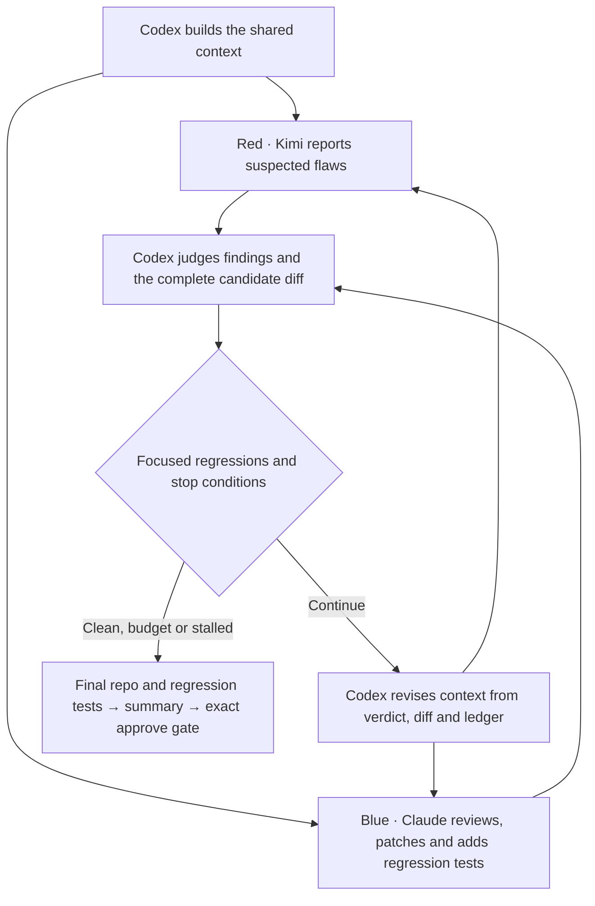

# council-flow

One coding task, three independent models, five stages, and a human gate before anything leaves the machine.

```
task ─► 1 plan (blind, parallel)  claude · codex · fx(Lyber)      plans/<member>.md
        └► blind judge: plans redacted of model names, shuffled A/B/C   judge/input.md, verdict.json
     ─► 2 implement  one implementer (codex by default) in a NEW worktree on council/<run-id>
     ─► 3 review     the other two, strictly read-only, strict JSON findings    reviews/round-<n>/
     ─► 4 fix loop   blocker/major left? findings back to the implementer, re-review   (max --rounds)
     ─► 5 finish     tests in the worktree, summary.md, then the gate:
                     tests pass + no blockers -> "Open PR?"   otherwise -> escalation with open findings
                     only "approve" commits, pushes council/<run-id> and runs gh pr create
```

Node 20+, ESM, no dependencies. Our own code; patterns learned from orca-council (see Credits).

## Setup (tested on Ubuntu 24.04)

1. **Node 20+** (tested with Node 24).
2. **Members**, each already logged in with its own subscription or key:
   - Claude Code: `claude auth login` (council-flow runs `claude -p --model opus`).
   - Codex CLI: `codex login`. council-flow uses Codex's own configured model (the top-level `model =` in
     `~/.codex/config.toml`) unless `COUNCIL_CODEX_MODEL` is set.
   - fx (Vercel) with a custom **Lyber** connection, see https://fx.sh/docs/configure-fx/custom-model-connections.
     The connection in `~/.fx/settings.json` points at the Lyber API endpoint and looks like this (council-flow never
     edits it):
     ```json
     { "providers": { "lyber": { "protocol": "openai-chat-completions", "base_url": "https://api.lyber.ai/v1",
                                 "auth": { "type": "bearer", "env": "LYBER_API_KEY" } } } }
     ```
     The key is read by fx from the environment. Export it in the shell that runs council-flow, without putting it
     in your shell history: `read -rs LYBER_API_KEY && export LYBER_API_KEY`.
3. **Orca** (optional): `orca` or `orca-ide` on PATH and the runtime up (`orca serve` or the app).
4. **gh** (only needed to open PRs after approval): `gh auth login`.
5. Clone council-flow and put it on PATH (no global npm changes):
   ```sh
   git clone https://github.com/tomi204/council-flow.git ~/council-flow
   ln -s ~/council-flow/bin/council-flow.mjs ~/.local/bin/council-flow
   council-flow doctor --repo ~/code/some-repo
   ```
   `doctor` prints one OK/FAIL line per piece and spends no tokens: `--version`, `claude auth status`,
   `codex login status`, `codex sandbox -- /bin/echo` (runs echo inside Codex's sandbox, no model call),
   `fx status --json`, the presence (never the value) of `LYBER_API_KEY`, `orca status --json`, `git --version`,
   `gh auth status`. Its output goes through the secret scrubber.

### Codex sandbox (bubblewrap) on Ubuntu 24.04

On a host that restricts unprivileged user namespaces, Codex's sandbox cannot start: every sandboxed command fails
with `bwrap: loopback: Failed RTM_NEWADDR: Operation not permitted`. Ubuntu 24.04 sets
`kernel.apparmor_restrict_unprivileged_userns = 1`, so the bubblewrap Codex ships
(`…/@openai/codex-linux-x64/vendor/x86_64-unknown-linux-musl/codex-resources/bwrap`) runs without the privileges its
network namespace needs. `codex exec -s read-only` and `-s workspace-write` both use that sandbox.

What council-flow does about it (detected by `doctor`, at run start, and from `bwrap:` errors in Codex output):
- Codex is **never the implementer** while its sandbox is broken; the implementer falls back to Claude.
- Codex can still plan, judge and review **from the prompt only**: it runs in an empty temp directory with the diff and
  the changed files' contents inlined (like fx), still with `-s read-only`.
- council-flow **never** falls back to `danger-full-access` or `--dangerously-bypass-approvals-and-sandbox`.

Options to fix it (council-flow applies none of them; each is a system change for you to decide):
1. **AppArmor profile for Codex's bwrap** (narrowest). As root, create `/etc/apparmor.d/codex-bwrap`:
   ```
   abi <abi/4.0>,
   include <tunables/global>

   profile codex-bwrap <npm-root>/@openai/codex/node_modules/@openai/codex-linux-x64/vendor/*/codex-resources/bwrap flags=(unconfined) {
     userns,
     include if exists <local/codex-bwrap>
   }
   ```
   Replace `<npm-root>` with the absolute path `npm root -g` prints (with nvm, for example
   `/home/<user>/.nvm/versions/node/*/lib/node_modules`; a `*` for the Node version covers Codex upgrades under any
   nvm Node version). Then run `sudo apparmor_parser -r /etc/apparmor.d/codex-bwrap`. This mirrors the profiles Ubuntu
   ships for its own bwrap-based apps. Re-check with `codex sandbox -- /bin/echo ok` and `council-flow doctor`.
2. **Relax the restriction system-wide**: `sudo sysctl kernel.apparmor_restrict_unprivileged_userns=0` (persist it in
   `/etc/sysctl.d/`). Simple, but it lowers that hardening for every program on the host.
3. **Do nothing**: keep Claude as the implementer and Codex as a prompt-only reviewer (what council-flow does now).

### Environment (placeholders only)

| Variable | Default | Meaning |
|---|---|---|
| `LYBER_API_KEY` | (unset) | Lyber key, read by fx only; passed to no other child, never written or printed |
| `COUNCIL_IMPLEMENTER` | `codex` | `codex` or `claude` (`--implementer`) |
| `COUNCIL_JUDGE` | `claude` | blind judge (`--judge`); falls back to another member if it fails |
| `COUNCIL_ROUNDS` | `2` | max fix rounds (`--rounds`, 0-5) |
| `COUNCIL_MEMBERS` | `claude,codex,fx` | who sits (`--members`); `claude,codex` skips Lyber entirely |
| `COUNCIL_CLAUDE_MODEL` | `opus` | |
| `COUNCIL_CODEX_MODEL` | Codex's configured model | |
| `COUNCIL_FX_PROVIDER` / `COUNCIL_FX_MODEL` | `lyber` / `kimi-k31-pro-abliterated` | alt: `deepseek-v4.1-flash-1017-abliterated` |
| `COUNCIL_CLAUDE_EFFORT` / `COUNCIL_CODEX_EFFORT` | (CLI default) | optional effort override |
| `COUNCIL_TIMEOUT_MS` | 900000 | per plan/judge/review call |
| `COUNCIL_IMPL_TIMEOUT_MS` | 2700000 | per implement/fix call |
| `COUNCIL_TEST_CMD` | detected | `--test-cmd`; detection: package.json `test` script, Makefile `test:`, pyproject/pytest, Cargo, go.mod |
| `COUNCIL_TEST_TIMEOUT_MS` | 600000 | |
| `COUNCIL_GATE_TIMEOUT_MS` | 1800000 | no answer in time = deny |
| `COUNCIL_ORCA` | `auto` | `auto` / `on` / `off` |
| `COUNCIL_ORCA_IMPLEMENT` | `orca` | in Orca mode: `orca` (Orca worker agent) or `headless` (confined headless CLI; Orca only for the gate) |
| `COUNCIL_ORCA_WORKTREE` | `new-child` | or `new-top-level` |
| `COUNCIL_*_BIN` | `claude`, `codex`, `fx`, `orca`/`orca-ide`, `gh` | binary overrides |

## Usage

```sh
# Offline rehearsal: fake members, fake Orca, fake gate (denies by default). No tokens.
council-flow "Add a /health endpoint with a test" --repo ~/code/api --dry-run

# Rehearse degraded mode: fx missing and claude timing out while reviewing.
COUNCIL_FAKE_MISSING=fx COUNCIL_FAKE_TIMEOUT=claude:review COUNCIL_TIMEOUT_MS=2000 \
  council-flow "Add a /health endpoint" --repo ~/code/api --dry-run

# Real run (prints progress on stderr; asks y/N at the end in a terminal, default No)
council-flow "Add a /health endpoint with a test" --repo ~/code/api --implementer codex --rounds 2

# From an issue (same pipeline)
council-flow issue --github 123 --repo ~/code/api
council-flow issue --linear ENG-42 --repo ~/code/api
council-flow issue --text-file issue.md --repo ~/code/api      # or --text-file - (stdin)

# Continue after a crash, Ctrl+C or a failed stage; finished stages are skipped, the gate is asked again
council-flow --resume 20261121-213000-1a2b3c4d --repo ~/code/api
```

Resume uses the run's **saved** configuration (members, models, rounds, test command, base branch, Orca mode), not
today's environment; only flags given on the resume command line override it. What resume does:
- an interrupted or failed fix is retried from the reviewed tree (a failed fix is always rolled back first);
- a review round in which no reviewer produced a valid review is retried, and the earlier findings stay open;
- if you edited the worktree after the run (e.g. after an escalation), the new tree is reviewed again;
- tests are re-run unless the same tree already passed with the same command;
- the gate is asked again, unless exactly this tree was already published; a half-finished publish (e.g. the PR step
  failed) resumes at the missing step.
A per-run lock file stops two council-flow processes from working on one run at the same time.

Exit codes: 0 the run reached the gate (approved or not), 1 bad usage, 2 the run failed (see `summary.md`).
stdout's last line is `<status>\t<run-id>\t<artifact dir>`.

Dry-run knobs (comma lists of `member` or `member:role`): `COUNCIL_FAKE_MISSING`, `COUNCIL_FAKE_TIMEOUT`,
`COUNCIL_FAKE_FAIL`, `COUNCIL_FAKE_BADJSON`; plus `COUNCIL_FAKE_REVIEW=once|always|clean`,
`COUNCIL_FAKE_FIX=change|noop|write-then-fail`, `COUNCIL_FAKE_JUDGE=first|merge`, `COUNCIL_FAKE_GATE=approve|deny`,
`COUNCIL_FAKE_CODEX_SANDBOX=ok|broken|runtime`, `COUNCIL_FAKE_REVIEW_FAIL_FROM=<round>`. A dry run never passes a
real credential to any child; `COUNCIL_FAKE_SECRET` injects a test sentinel as the fake fx's key. With
`COUNCIL_ORCA=on` the dry run drives the Orca code path against `test/fixtures/fake-orca.mjs`.

## Local security review with `audit`

`council-flow audit` starts from a committed local Git tree. Kimi and Claude review each version of the shared context in parallel. Codex judges both outputs and revises the context when another iteration is needed.



**Audit safety principles**

- **Local only.** The target is a local Git repository, a path inside it, or a loopback service with an explicit
  port, on a machine you own or are authorized to test. Production systems, third-party hosts and anything you do not
  own are out of scope: council-flow rejects a non-local `--target` before any model call.
- **No network egress.** The workflow sends no traffic to the target, not even a loopback service, and contacts no
  public URLs, other parties' APIs or other hosts. The only exception is each model CLI talking to its own provider.
- **Exact approval gate.** No change is committed unless the owner answers exactly `approve`.
- **Scrubbed artifacts.** Everything a run writes goes under `.council-flow/<run-id>/` (findings, Red and Blue
  reports, patches, context versions and a final `summary.md`, see the table below), with secrets scrubbed.
- **Findings-only Red team.** Red reports suspected flaws only: no exploit code, payloads, PoCs or attack steps.
  Fixes and regression tests come from Blue.
- **Codex without a sandbox.** If Codex's sandbox cannot start (see "Codex sandbox" above), Codex builds context,
  judges and reviews from the prompt only, and Claude implements.

See also [`SECURITY.md`](SECURITY.md).

```sh
council-flow audit "Review authorization in the file reader" --repo ~/code/reader --target src/reader.js --dry-run
council-flow audit "Review request parsing and its trust boundaries" --repo ~/code/api --target localhost:3000 --rounds 1
council-flow audit --repo ~/code/api --resume <run-id>
council-flow audit --repo ~/code/api --resume <run-id> --refresh-context
```

**Target and scope.** Pass the Git repository root. An omitted target means that repository. A path target must exist inside it and have tracked regular files at the reviewed commit. A loopback target requires an explicit port (1–65535) and a literal `localhost`, dotted IPv4 address in `127.0.0.0/8`, or `[::1]`. HTTP and HTTPS prefixes are optional. **No traffic is sent to the target**, even for a loopback service. Its port and likely entry file are described using source evidence. Commit the code you want reviewed first. The context collector excludes symlinks, limits the file list and excerpts, and summarizes configuration by name. The review can miss issues outside the supplied evidence.

For tests outside a narrow production target, pass `--test-target <file-or-directory>` on the initial run. You can name a new test file under an existing directory. Both scopes are pinned on resume. A package whose committed test script is `node --test` also authorizes the matching sibling test of the changed source, for example `src/reader.test.mjs` for `src/reader.mjs`. Every other changed path must be inside the production target. Audit checks additions and deletions independently, including across renames.

**Roles and spend.** Each iteration normally uses four model calls. Codex builds or revises the pack. Red receives its lean brief, scrubbed source excerpts, ledger and starting diff. Red uses `fx >= 0.0.17`, provider `lyber`, model `kimi-k31-pro-abliterated`, and `--permission-mode ask` with a tool-free profile. That model is a variant with reduced refusal behaviour, chosen so that the Red role reports suspected weaknesses in security-sensitive code instead of declining to discuss them. Red output is findings-only and machine-screened: council-flow checks every Red reply with conservative heuristics and rejects one that looks like code, commands, payloads or step-by-step procedures before it is stored or passed to Blue. Claude Opus receives the same pack hash and reviews the same starting tree. In iteration one Claude can propose a concrete hardening change with its own finding ID and a regression test, or return an empty patch. In later iterations it also addresses confirmed findings, rejected patches and test failures from the previous verdict.

Codex reviews the two independent reports, the incremental patch and the complete base-to-candidate diff from a read-only prompt. It gives a reason for every finding decision (confirmed, false positive or needs more information) and every patch decision. A finding becomes fixed when Codex verifies its source change and regression, and council-flow executes that focused test successfully on the reviewed tree. Missing evidence stays open. Claude can substitute as a read-only builder for a full pack. A Codex verdict is required in every iteration.

**Stopping.** The default budget is three iterations. A clean iteration introduces no new confirmed findings and leaves every confirmed finding fixed, with no outstanding questions, rejected patches or review concerns. Two consecutive iterations with an unchanged open set and unchanged candidate tree escalate for owner review. The summary records `clean`, `no-progress`, or `max-rounds`. Reaching the budget can leave findings open. With `--rounds 0`, both teams review once, Claude has read-only tools, and Codex judges their reports.

**Isolation and approval.** Audit Git subprocesses and repository/regression tests run with kernel-enforced network restrictions. Tests run from disposable copies of the reviewed Git tree with a private home and restricted filesystem access. Audit copies locally installed `node_modules` beside tracked package manifests into the disposable tree. Relative dependency links resolve there, including npm’s local binaries. Tests with mutable installations run again on resume. Focused receipts record the candidate tree, finding IDs, file, runner and arguments. Supported invocations include Node’s test runner, package-declared Jest, Vitest or Mocha, pytest, Ruby test files and named Cargo integration tests. An unsupported focused runner leaves the fix unverified and prevents a local commit. This version uses Linux x86-64 or arm64, `/usr/bin/python3`, `libseccomp.so.2`, and Landlock ABI 3+ for test isolation. Unsupported isolation fails closed. Audit uses a local terminal gate, including inside Orca. Only literal lowercase `approve` can commit a tested change to the local `council/<run-id>` branch. The primary checkout stays on its current commit. Audit has no push or PR stage. A dry run uses the fake gate and models, runs the actual offline tests, and simulates any approved commit.

**Artifacts and resume.** Under `.council-flow/<run-id>/`:

| Path | Contents |
|---|---|
| `context/v<n>/` | Immutable pack in JSON and Markdown, Red and Blue briefs, builder, commit, starting tree and pack hash |
| `iterations/<n>/red/`, `iterations/<n>/blue/` | Independent reports bound to the pack hash, starting tree and Blue candidate |
| `iterations/<n>/review/` | Codex verdict with finding and patch decisions, concerns, context delta and focused test receipts |
| `findings.md` | Location, severity, impact, reasoning, fix direction and status history by iteration |
| `patches/<n>.diff`, `worktree/` | Scrubbed incremental diff for each iteration and the council worktree with exact proposed files |
| `tests/`, `summary.md`, `gate.json` | Final tree-bound test receipts, iteration table, stop reason and owner decision |
| `run.json`, `logs/`, `publish.json` | Resume checkpoints, usage, role argv and local commit receipt on approval |

Resume with the same subcommand and dry-run setting. Each team checkpoints independently. After an interruption, a completed report or verdict is reused for its pack and candidate. Unfinished Blue edits roll back to the iteration’s starting tree. Extending a spent round budget continues with another context revision. An explicit `--refresh-context` or an owner edit to the scoped candidate requests a full pack and one fresh review, preserving prior versions and ledger history. Automatic follow-up iterations still use the original round limit. The judge always receives the diff from the original base. Outstanding patch rejections, review concerns or failed tests prevent publication. Local prior findings can inform a new run. Each model call saves scrubbed stdout and final text under `logs/<call>.stdout.txt` and `logs/<call>.final.txt`, before validating the reply. File-tool contents are omitted. Red logs retain only safe finding content or a validation diagnostic. Repository test logs omit raw project output.

Audit accepts prose around the final JSON block and Markdown fences. A malformed report gets one text-only JSON repair in empty scratch. Look for `<call>.validation.json` and `<call>-nudge.*` in `logs/`. Resumed calls use an attempt suffix to preserve the earlier logs. If one team fails, its reason appears in `iterations/<n>/<team>/failure.json`. Codex judges the surviving report and the loop retries in the remaining budget. An incomplete iteration cannot finish clean or publish. Exhausting the budget or stalling with a missing report records `team-incomplete`. If both teams fail, the run stops for resume.

Scrubbed previews omit configuration values and non-source hunks. Inspect the private worktree for the exact patch. The read-only roles receive scrubbed text. Claude’s patching tools can read original worktree files. Choose a repository you are authorized to share with the model providers.

## Orca modes

**Orca orchestration is used only from inside an Orca terminal.** Every `orca orchestration` verb needs a calling
terminal; from a plain shell Orca answers `no_active_sender_terminal` (verified with Orca 1.4.259). So `COUNCIL_ORCA=auto`
picks:

- **Orca mode** when `ORCA_TERMINAL_HANDLE` is set and `orca status --json` reports the runtime reachable:
  `run-create`, `task-create` (implement prompt on stdin), `worker-start --task <id> --worktree new-child --agent
  codex|claude --name council-<run-id> --repo path:<repo> --base-branch <base sha> --setup skip` (no repository setup
  hooks), then `check --wait --types worker_done,escalation --run <run>`. Only a `worker_done` for exactly that dispatch
  with an explicit `succeeded` outcome counts; other mail is kept in `orca/mail.jsonl` (a worker question becomes a
  warning). Fix rounds are `send --to dispatch:<id>`; when Orca turns that into a follow-up Task, council-flow waits on
  the follow-up dispatch. A resumed run first asks `worker-show` whether the dispatch already settled.
  The worker's worktree is taken only from explicit worktree fields of the receipt and must be a registered linked
  worktree of the repo (never the primary checkout).
  The decision gate is `gate-create` on its own task, polled read-only with `gate-list`, so it shows up in the Orca
  app and on the phone. It approves only when that exact gate id reports status `resolved` with resolution exactly
  `approve`, and not when the record says an agent/worker resolved it. (`orchestration ask` is not used as a gate: it
  is a worker-to-coordinator question, which an agent can answer.)
  **The Orca implementer is your Orca agent with your Orca permission settings**; council-flow cannot enforce
  read/write limits on it (the run records a warning). `COUNCIL_ORCA_IMPLEMENT=headless` keeps Orca for the gate but
  runs the confined headless implementer instead.
- **Git-worktree fallback** otherwise: `git worktree add -b council/<run-id> <repo>/.council-flow/<run-id>/worktree`,
  the implementer runs headless there, and the gate is a `y/N` prompt in the terminal (default No; no terminal =
  deny). `doctor` says which mode you will get and why.

### Automation wiring (GitHub / Linear issues)

An Orca automation starts an agent in an Orca terminal. Have that agent start council-flow in its own Orca terminal
and end its turn, so council-flow becomes the coordinator (its gates reach the phone) and no agent tool timeout cuts
a long run short:

```sh
orca automations create \
  --name "council-flow: issues labelled council" \
  --trigger hourly \
  --provider claude \
  --repo path:$HOME/code/api \
  --precheck "gh issue list --label council --state open --json number -q '.[0].number' | grep -q ." \
  --prompt "Take the oldest open GitHub issue labelled council (gh issue list --label council --state open --json number). Relabel it so it is not picked twice: gh issue edit <n> --remove-label council --add-label council-running. Then run: orca terminal create --worktree active --title council-flow --command 'council-flow issue --github <n> --repo .' --json, and end your turn. Never push, merge or open PRs yourself: council-flow asks for approval through an Orca decision gate."
```

For Linear use `council-flow issue --linear <ENG-123>` (reads `orca linear issue <id> --json`) and find candidates
with `orca linear list`. **Not exercised live:** the automation, `worker-start`, `check --wait` and the gate have
only run against the fake Orca CLI (see Known limitations).

## Orca plugin

council-flow is also an Orca plugin: **Council Flow**, a panel in Orca's right sidebar, a status bar item and five
command-palette commands. The manifest is `orca-plugin.json` at the repository root (Orca's Git installs read it
there) and the code is in `plugin/`. Plugin key: `local.council-flow` for a dev load or folder install,
`tomi204.council-flow` when installed from GitHub.

The plugin does not reimplement anything. **Run** opens **one new Orca terminal** in the chosen workspace
(`terminal.create`) running `node <checkout>/bin/council-flow.mjs …`. Because it is an Orca terminal,
`ORCA_TERMINAL_HANDLE` is set inside it. Coding runs therefore get Orca orchestration and the Orca decision gate.
Audits keep their terminal gate (see `audit` above). The plugin never types into a terminal.

### Use it

Open it from the Council Flow icon in the right sidebar, or with `orca plugin open local.council-flow` (or
`tomi204.council-flow`). `plugin open` needs the desktop app: a windowless `orca serve` refuses it.

1. **Say what the council should do** in the one prompt box, for example "Review authorization in the request
   handler", and press **Run**. That is all a first run needs.
2. **Audit | Code** is picked from your words: review, audit, inspect, find or any security language means *audit*;
   add, implement, build, fix, refactor or write means *code*; anything unclear is *audit*. Click the other one to
   override it. Your pick holds until the prompt reads as the other mode, or you pick again.
3. **Dry run** is on until you turn it off: fake members and a fake gate that says no, so no tokens are spent. Turn
   it off for a real run.
4. **Repo** is the focused Orca workspace when it is a local Git checkout; the dropdown picks another one.
5. **Options** (closed by default): audit target (blank = the whole repository, a path in it, or
   `localhost`/`127.x.x.x`/`[::1]` with a port), test target, iterations, refresh context; for code, the implementer
   and fix rounds; a repository folder; and the exact command Run will start.

**Workflows** below lists the runs: waiting for approve first, then running ones, then recent finished ones, from this
repository and the others the plugin started runs in. Each card shows the prompt, repository, mode, status (Running,
Waiting for approve, Done, Failed, Interrupted), elapsed time, findings, and where the run is. For an audit that is
the loop `context → red & blue → Codex review → re-context → …` with *iteration N/M*; for code,
`plan → implement → review → fix → tests → approve`. All of it is read from the run's own `run.json`, its lock and
the times `summary.md` and `gate.json` were written; the plugin keeps no state machine of its own.

- **Waiting for approve** is a yellow card with a bell, and the status bar says "Council Flow: waiting for approve".
  **Jump to terminal** shows the run's terminal, where you type `approve` yourself (a coding run's gate can also be
  in Orca). The plugin never types, pastes or sends `approve` or any other answer.
- **Open terminal** shows a run's terminal; **Summary** and **Findings** open `summary.md` and `findings.md` in the
  panel (scrubbed again, first 256 KiB, paged); **Resume** (interrupted or failed runs) opens a new terminal with the
  run's own subcommand and dry-run setting.
- **The gear** opens Setup: which council-flow runs (the checkout the plugin was loaded from, or a folder you set),
  **Run doctor** in a new terminal, and what this Orca allows.

The list stays current without polling the panel: the worker watches `.council-flow/` and each live run folder with
`fs.watch` and tells the panel when one changes; the panel also re-reads on Orca's `workspace.changed` (a terminal
opened, closed or renamed). Because the plugin has a status bar item, Orca keeps its worker running; while a run is
live it re-checks every 15 seconds, to notice a council-flow process that ended without writing anything (for example
a closed terminal).

| Palette command | What it does |
|---|---|
| Council Flow: Run this workspace's last audit prompt again | repeats the last audit started from the panel for the focused repository |
| Council Flow: Run this workspace's last coding prompt again | the same for a coding run |
| Council Flow: Resume the latest interrupted run | resumes the newest interrupted or failed run of the focused repository |
| Council Flow: Show the terminal of the run waiting for approve | the same as Jump to terminal; also what the status bar item does |
| Council Flow: Run doctor in a new terminal | `council-flow doctor --repo <workspace>` |

The commands a terminal runs (`run` is the CLI's explicit name for the coding pipeline; `--` stops a prompt from
being read as an option; the plugin picks the run id, in council-flow's format, so the panel can find the run):

```text
node <checkout>/bin/council-flow.mjs audit --repo <repo> [--target …] [--test-target …] [--rounds N] [--refresh-context] [--dry-run] --run-id <id> -- '<prompt>'
node <checkout>/bin/council-flow.mjs run --repo <repo> [--implementer codex|claude] [--rounds N] [--dry-run] --run-id <id> -- '<prompt>'
node <checkout>/bin/council-flow.mjs audit --repo <repo> --resume <id> [--refresh-context] [--dry-run]
node <checkout>/bin/council-flow.mjs --resume <id> --repo <repo> [--dry-run]
node <checkout>/bin/council-flow.mjs doctor --repo <repo>
```

### Access it asks for

| Grant | Used for |
|---|---|
| `trusted-worker` (execution) | `plugin/src/worker.ts` runs in a Node process on the Orca host: it reads `.council-flow/` run folders (read-only, watched with `fs.watch`) and builds the command line |
| `workspace:read` | list workspaces (the repository defaults to the focused Git workspace) and their terminals (is a run's terminal still open?) |
| `workspace:write` | `terminal.focus` only: **Open terminal** / **Jump to terminal** show a terminal the plugin opened. Orca's wording for this capability also covers opening and renaming workspaces, opening files and running built-in commands. The plugin does none of that, and the tests check it |
| `terminal:send` | `terminal.create` only: one new terminal per run. Orca's wording for this capability also covers typing into terminals. The plugin never does that (no `terminal.sendText`), and the tests check it |
| `storage:own` | each repository's last prompt and options (for the palette commands), the terminals it opened, an optional council-flow path |

It also contributes one status bar item, which keeps its worker running while the plugin is enabled. It does not
request: secrets, settings, notifications, `terminal:read`, agent, automation or history access. It has no hooks or
event subscriptions in the manifest and makes no network calls.

### Turn on plugins (headless `orca serve`)

On a Linux host that runs headless `orca serve` on its default runtime, every host-side plugin command fails, and so
does the switch that should turn plugins on:

```text
$ orca plugin list --json        # also: plugin system on, dev load, install, open
error.code: runtime_error   message: Plugin service is not available on this runtime
```

The cause: on Linux, `orca serve` runs Orca's Node server `orcad` by default (`orca serve --help`: "On the orcad
runtime (the default)"). Orca's own source says "`ORCA_SERVE_RUNTIME=electron` keeps `orca serve` on Electron; orcad is
the default". Only the Electron runtime creates the plugin service, so `orca plugin system on` (the same switch as
"Turn on plugins" in Settings → Plugins) has nothing to switch on. `validate`, `check`, `test` and `inspect` work
without it, because they run on the plugin folder.

To get plugins on such a host, restart Orca's server on the Electron runtime (pause running work first: this stops the
current server), then turn plugins on once:

```sh
ORCA_SERVE_RUNTIME=electron orca serve      # keep the --port / pairing flags you normally pass
orca plugin system on --json
```

Electron needs a display. On a headless host, run it against a virtual X display and set `DISPLAY` accordingly. You
can also turn plugins on from a desktop Orca app (Settings → Plugins → "Turn on plugins"), but its worker then runs on
that desktop's machine, so council-flow and the repositories must be there too.

### Install

Load or install it from the Orca host that holds the repositories:

```sh
# A) from GitHub (Orca pins the exact commit it installs)
orca plugin install tomi204/council-flow --json
# B) develop from a local checkout (Orca reloads it on save)
orca plugin dev load <path-to-council-flow> --json
# C) a pinned copy of a local checkout
orca plugin install <path-to-council-flow> --json
```

Each of these first exits `3` with `approval_required`. `error.data` lists what would be granted (it must be exactly
`trusted-worker`, `workspace:read`, `workspace:write`, `terminal:send`, `storage:own`, one panel, five commands and one
status bar item; `orca plugin inspect <path-to-council-flow> --json` prints the same before you start).
`error.data.command` is the same command with `--approve <fingerprint>`. If the list matches, re-run that command, for
example:

```sh
orca plugin install tomi204/council-flow --approve <fingerprint> --json
orca plugin list --json            # Council Flow: running or idle
```

The fingerprint is bound to this plugin, version, files and access. A version with new access asks again (0.2.0 added
`workspace:write`, the status bar item and the jump command). Only use a fingerprint Orca printed for that exact
command.

### Safety (unchanged)

- **Local targets only.** `--target` is passed through, and council-flow still refuses a non-local target before any
  model call. The panel also refuses non-loopback hosts early. That check uses the CLI's own rules and is never more
  permissive (`test/plugin.test.mjs` compares the two).
- **The gate is yours.** The plugin never types into a terminal. Jump to terminal only moves focus. It never sets
  `COUNCIL_FAKE_GATE` or any other variable, and it cannot answer an Orca gate. The command line can never contain a
  control character: a newline would be type-ahead that a waiting gate could read as an answer, so free text is folded
  to one line and other control characters are refused.
- **Secrets.** The plugin reads no environment variables. `LYBER_API_KEY` stays in your shell, and council-flow
  passes it only to fx, as before. council-flow's scrubbing is unchanged, and the panel scrubs artifacts again before
  showing them.
- **No new abilities.** The plugin only integrates the existing CLI into Orca: it adds no exploit code, payloads or
  probes.

### Plugin tests

```sh
npm test                                   # includes test/plugin.test.mjs (manifest, parser, target and scrub parity, one dry run)
orca plugin validate . --json && orca plugin check . --json
orca plugin test plugin --json             # mode pick, progress, command builder, run reader, worker and panel
(cd plugin && npx -p typescript@5 tsc -p .)
orca plugin shot . --scenario waiting-approve --out waiting.png --json   # scenarios in plugin/src/panel.check.ts; needs the desktop app
```

## Artifacts

Run artifacts live in `<repo>/.council-flow/<run-id>/`. Coding mode adds `.council-flow/` to `.git/info/exclude`. Audit uses a private ignore file inside `.council-flow/` and leaves the shared Git exclude file alone.

```
run.json                 state: config (no secrets), member status + reasons + token usage, stage status + timings,
                         worktree (mode, path, branch, base commit, Orca ids), loop stop reason, outcome, warnings
brief.md                 the planning brief (task + repo summary)
plans/<member>.md        each blind plan, as written (written only after the judge decided)
judge/input.md           exactly what the judge saw (redacted, shuffled)      judge/output-<member>.txt
verdict.json             {choice, rationale, judgePlan, judge, labels: {A: member, ...}, chosenMember}
plan.md                  the judge's version of the plan (what the implementer gets) + the selected original
implement/               prompt.md, log.txt, diff.patch, meta.json (worktree, base, stats, tree)
reviews/round-<n>/       <member>.json (status, findings), merged.json (tree reviewed, deduplicated findings)
fix/round-<n>/           prompt.md, log.txt, incremental.patch, diff.patch (cumulative), result.json (before/after tree)
tests/                   output.txt, result.json (tree and command tested)
summary.md               task, chosen plan, candidate tree, diff stats, open findings, tests, degradations, next steps
gate.json, publish.json  the decision with its binding {tree, base, worktree, dest}; publish steps (commit, push, PR)
orca/                    Orca receipts and any mail that was not the awaited completion (Orca mode only)
logs/<call>.argv.json    the exact argv of every member call (no prompt, no secret), plus scrubbed stdout/stderr
worktree/                git-mode worktree on council/<run-id> (changes staged, not committed)
```

Member output is buffered and written only after every member in a parallel stage has finished, so a planner
cannot read another planner's answer from disk mid-run; plan texts are written only after the judge decided, so a
judge with read access, or a retried planning stage, finds no plan on disk. The artifact folders are created with
an exclusive `mkdir`, mode 0700, and no path component may be a symlink.

## Read-only guarantees per engine (enforced by flags, not by prompt)

| Member | Read-only roles (plan, judge, review) | How it was verified |
|---|---|---|
| claude | `--tools Read,Grep,Glob` (judge: `--tools ""`), `--permission-mode dontAsk`, `--permission-prompts none`, `--restricted` (no code-running tools, no user/project settings, file tools confined to the working dir), `--strict-mcp-config` (no MCP servers), `--no-session-persistence` | `claude --help` 2.1.330 |
| codex | `exec -s read-only --ignore-user-config --ignore-rules -c mcp_servers={} --ephemeral --json`, prompt on stdin; with a broken sandbox it runs prompt-only in an empty temp dir and never implements | `codex exec --help` 0.169.0; `mcp_servers` key found in the codex binary |
| fx | `ask --permission-mode ask` **and** `FX_PERMISSION_MODE=ask` (fx's saved default can be `auto`!), never `--auto/--full-access/--yolo`, runs in an empty temp dir with the diff and file excerpts inlined; fx can never be the implementer | fx 0.0.17 usage string in the binary; `fx permissions --json` |

Implementers: claude gets `Read,Grep,Glob,Edit,Write` (no Bash) with `acceptEdits` and `--restricted` in the worktree;
codex gets `-s workspace-write -C <worktree>`. Every dry-run call goes through `test/fixtures/fake-engine.mjs` with the
exact argv the real CLI would get, and the fake **refuses to run** if a read-only role is missing any of the flags
above, if fx is asked for auto/full-access, if a prompt is in argv, or if `LYBER_API_KEY` reached a non-fx child.
`docs/flags.md` lists every flag, how it was checked, and the substitutions.

## Secrets

- Each child process gets only the credentials it needs (`src/env.mjs`): `LYBER_API_KEY` only fx; `ANTHROPIC_*` /
  `CLAUDE_CODE_OAUTH_TOKEN` only claude; `OPENAI_*` / `CODEX_*` only codex; `GH_TOKEN` / `GITHUB_TOKEN` only gh and the
  approved push. git and the repo's test command get no secret and no inherited `GIT_DIR` / `GIT_INDEX_FILE` /
  `GIT_CONFIG_*` overrides. No child inherits a Claude Code host session's markers.
- Every prompt, every Orca argument and stdin, every artifact and every line printed is scrubbed: exact values of
  secret-named env vars, `Bearer`/`Basic` credentials in any letter case, token shapes (`sk-…`, `ghp_…`, …), and in
  logs also `KEY=value` and JSON secret fields. Secrets never go in argv. Run ids are a timestamp plus random hex, never
  task text.

## The gate and publishing

- The default answer is always **no**: no TTY and no Orca = deny; timeout = deny; Orca error = deny. Approval is the
  complete answer `approve` (`y`/`yes` at the TTY prompt); "approve after the tests pass" is a deny.
- The gate is asked about one **candidate tree** (the git tree id of the reviewed, tested change) on a recorded base
  commit, worktree and destination `council/<run-id>`; the answer is stored with that binding. `publish()` refuses any
  approval whose binding does not match the run (tree, base, worktree, destination, repository), verifies the worktree again, then commits **exactly that tree** with
  `git commit-tree <tree> -p <base>` (nothing is staged again, so files written by tests or edits made while the gate
  was open are not included), pushes `<commit>:refs/heads/council/<run-id>` with `--no-follow-tags` (never `--force`,
  never a `+` refspec, never deletes a branch) and runs `gh pr create --head council/<run-id> --base <base>
  --body-file summary.md` (`--draft` when the run was escalated). Each step is checkpointed in `publish.json`.
- With `--base-branch`, the worktree starts from that branch, so the reviewed diff is the PR diff. If the base commit
  is not on `<remote>/<base>` (unpushed local commits), or the run started from a detached HEAD, or `<remote>/<base>`
  is not fetched locally, the run escalates: the PR base cannot be verified.
- The PR goes to the push remote's repository: council-flow derives `HOST/OWNER/REPO` from the remote's configured URL,
  binds it into the approval and passes `gh pr create --repo …` (`GH_REPO` is ignored). A non-GitHub remote is pushed
  but gets no PR (`pushed-no-github-repo`). Before the PR step the remote branch must still hold exactly the approved
  commit, else `remote-moved` and no PR.
- Tests run only on a tree with a valid review (otherwise they are skipped and the run escalates); a test command that
  contains a secret is refused. After the tests, anything they wrote is undone in the worktree.
- council-flow runs every git command with hooks disabled (`-c core.hooksPath=/dev/null`, no fsmonitor), including its
  commit and push: your pre-commit/pre-push hooks do not run for council-flow's own commit.
- Tests prove it against a real local bare remote: deny leaves only `main`; approve adds only `council/<run-id>` with
  the candidate tree; a divergent remote `council/<run-id>` is not overwritten; an unpublished annotated tag with
  `push.followTags=true` is not pushed; an approval bound to another tree publishes nothing.

## Cost notes

Claude and Codex run on their subscriptions. **Lyber (fx) is paid per token**, so fx gets lean prompts: plans get the
brief (task + capped repo summary), reviews get at most 40 KB of diff and 24 KB of changed-file excerpts, and fx uses a
short `--system` prompt instead of its coding-agent prompt. Token counts per member (when the CLI reports them)
are in `run.json` and the summary table. A typical run is 1 fx plan call plus 1 fx review call per review round
(at most `rounds + 1`). To skip Lyber: `COUNCIL_MEMBERS=claude,codex`. Cheaper model:
`COUNCIL_FX_MODEL=deepseek-v4.1-flash-1017-abliterated`. Rehearse with `--dry-run` first: it costs nothing.

## Troubleshooting

| Symptom | Fix |
|---|---|
| `FAIL fx ... LYBER_API_KEY is not set` | `read -rs LYBER_API_KEY && export LYBER_API_KEY` in this shell |
| `fx provider "lyber" is not configured` | add the connection (above); check with `fx status --json` |
| doctor: `orchestration not used ... ORCA_TERMINAL_HANDLE unset` | expected in a plain shell; run from an Orca terminal for Orca mode |
| `branch council/<id> already exists` | pick another `--run-id`; council-flow never deletes branches |
| tests fail in the worktree because dependencies are missing | `--test-cmd "npm ci && npm test"` (worktrees have no `node_modules`) |
| doctor: `FAIL sandbox ... bwrap` | Codex's sandbox cannot start; see "Codex sandbox" above (Claude implements meanwhile) |
| `run <id> is in use by process N` | another council-flow is on that run; wait, or stop it (a dead owner's lock is taken over) |
| `worktree check failed` | the recorded worktree is not this run's linked worktree any more; inspect it, do not force |
| run stopped (Ctrl+C, crash, failed stage) | `council-flow --resume <run-id> --repo <repo>` |
| the gate denied because nobody could answer | resume in a real terminal: the gate is asked again |
| cleaning up | `git worktree remove <worktree>` then `git branch -D council/<run-id>` (manual on purpose) |

## Tests

```sh
npm test        # node:test suite, offline, no logged-in CLIs needed (dry-run fakes and PATH stubs)
orca plugin test plugin --json   # the Orca plugin's own tests (see "Orca plugin")
```

Covered: blind redaction (task and plans) and shuffling, judge JSON parsing and the one retry, strict findings
validation, flags per member and role, output parsers, the per-child environment, a **real (non-dry-run) CLI run with
stub binaries on PATH** that records every child's argv, stdin and secret env (only fx gets the Lyber key, nothing
secret in any argv/stdin/artifact/output, git and tests get no secrets or `GIT_*` overrides), degraded mode
(missing, timeout, too few planners, judge and implementer fallback, invalid reviewer, Codex sandbox broken at probe
time and at run time), the fix loop (clean, max rounds, `--rounds 0`, no-op fix, failed fix rolled back and retried,
unreviewed round kept open and retried), resume (saved config, edited worktree re-reviewed, failed tests re-run,
partial publish finished), the gate (exact answer, bound gate id/task/status, agent-resolved gate refused), publishing
against a bare remote (exact tree, no force, no tags, stale approval refused), worktree identity checks, symlink
handling, hooks disabled, the process-group kill, the run lock, Orca mode against the fake Orca CLI, doctor.

## Known limitations

- The Orca orchestration path (worker-start, check --wait, send, worker-show, gate-create/gate-list) and the
  automation wiring have not run against a live Orca: they need an Orca terminal and would start a real agent.
  Receipt JSON is parsed strictly but its shape is not documented, so the first live run may need adjusting.
- In Orca mode the implementer is Orca's interactive agent, so its permissions follow your Orca agent settings;
  council-flow's sandbox flags apply to headless implementers only (`COUNCIL_ORCA_IMPLEMENT=headless`). Orca picks
  the local branch name; the PR branch is still `council/<run-id>`.
- The Orca gate refuses resolutions the record attributes to an agent, but Orca does not document who resolved a gate;
  any process with the orca CLI in your session could resolve it.
- Where Codex's sandbox cannot start (see "Codex sandbox" above), Codex plans and reviews from the prompt only.
- The Orca plugin needs Orca's plugin service, which headless `orca serve` provides only on the Electron runtime (see
  "Turn on plugins"). Its worker, panel and command lines are covered by `orca plugin test`/`check` and
  `test/plugin.test.mjs`.
- The plugin's terminals come from Orca's `terminal.create`, the same call `orca terminal create` makes, so they should
  carry `ORCA_TERMINAL_HANDLE` like any Orca terminal; that is not verified live. Orca shows such a terminal as a
  background tab (**Jump to terminal** brings it forward); with no window to adopt it, it stays a background terminal,
  and an audit's terminal gate then times out to deny.
- The plugin's "waiting for approve" is inferred from what council-flow writes (an audit's `summary.md` newer than
  its tests and no newer `gate.json`; a coding run's `gate` stage with no `gate.json` yet). It is covered by tests and
  check scenarios, not yet by a live run. The status bar item and `plugin shot` need the desktop app.
- The repo's own test command runs with your user's privileges inside the worktree (no secrets in its env, but not
  sandboxed).
- `-c mcp_servers={}` for Codex is defence in depth; its effect on project-level config has not been observed.
- Reviewers see capped diffs (120 KB for claude/codex, 40 KB for fx); huge changes are truncated.

## Credits

Patterns (spawn specs with built-in read-only flags, stream-json result parsing, codex `-o` answers, a text-only
blind judge, redacted and shuffled answers, fake engines) were learned from
[orca-council](https://github.com/VukanCekic/orca-council) by Vukan Cekic (MIT, commit `74b7232`). The help captures
in `docs/help/` come from Orca (MIT), Codex CLI and fx (both Apache-2.0). See `THIRD_PARTY_NOTICES.md`.
council-flow is MIT, see `LICENSE`; security and acceptable use are in `SECURITY.md`.
